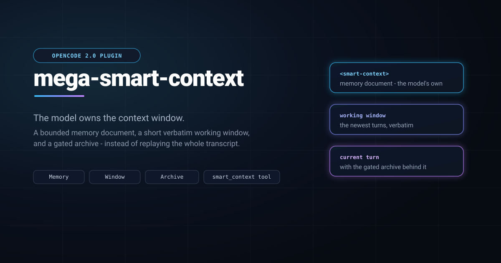

<div align="center">



</div>

# mega-smart-context

An OpenCode 2.0 plugin that hands context management to the model. Instead of replaying the whole transcript, every request carries the memory document the model wrote, a short verbatim working window, and the current turn.

<div align="center">

[](LICENSE)
[](package.json)
[](https://github.com/topics/opencode-plugin)
[](package.json)
[](https://www.paypal.me/mega3dp)

</div>

## What it does

- The model writes a **memory document** with the `smart_context` tool — the goal, plan, facts, files, decisions and open threads — and every request starts with it.
- A short **verbatim working window** keeps the newest turns exactly as they happened, so nothing in the live tool loop is paraphrased.
- When a turn leaves the window it moves to a **gated archive**, kept for `recall` rather than replayed or dropped silently.
- **Compaction is owned by the plugin.** When the host makes a checkpoint, the plugin answers with the memory document itself instead of a separate summarization call.
- **Subagents are managed independently**, each with its own window and memory, so a child never inherits the parent's context.
- `/context` prints the current memory and archive; `/context now` archives pending turns.

## Requirements

- OpenCode 2.0.
- Node 22 or newer. The host loads the TypeScript source directly; there is no build step and no runtime dependency.

## Install

Project scope (this repository only):

```sh
npm run plugin:install:project
```

User scope (every project on this machine):

```sh
npm run plugin:install
```

Check what is installed and whether it has drifted from the source tree:

```sh
npm run plugin:status
```

Remove the selected scope:

```sh
npm run plugin:uninstall
```

Installing copies the shippable files and removing deletes them; editing the source tree does not change an installed copy until you reinstall. OpenCode picks up a re-synced or removed copy at its next load, so restart it only to make that immediate — and always after a *first* install, when the host has not seen the directory yet.

> **Do not run this alongside `mega-skillstate`** (or any other plugin that rewrites the context hook). Both rewrite the same request and both may own compaction. Disable the other plugin first.

> **Install one scope, not both.** OpenCode reads both discovery roots and keys a plugin by the path it was loaded from, so a user copy and a project copy are two instances of this plugin in a session in that repository: two window passes per request, two owners of compaction, two `/context` commands. Pick user scope to cover every project, or project scope to cover this repository alone. `npm run plugin:status` prints both, so a stray copy is visible there.

## Configure

On first run the plugin writes `~/.config/opencode/mega-smart-context.json` with every default and never overwrites it. Layers, most specific last:

1. built-in defaults,
2. the package `options.json`,
3. the host's plugin options,
4. the user file.

An unknown key or a wrong type is an error; the plugin refuses to load rather than silently keeping a default.

The settings a user normally touches:

| Setting | Default | Meaning |
| --- | --- | --- |
| `enabled` | `true` | master switch |
| `memoryTokens` | `50000` | cap on the model-authored memory, estimated |
| `workingTokens` | `16000` | cap on the verbatim working window, estimated |
| `autoArchive` | `true` | archive unhandled evictions instead of dropping them |
| `evictionLead` | `1` | new user turns a pending turn is shown before archiving |
| `parentArchive` | `true` | let a subagent search its spawning session's archive (`from:"parent"`) |
| `expandDigestChars` | `4000` | characters per `expand` page, clamped by `maxResultChars` |
| `subagents` | `true` | manage child sessions independently |
| `refs` | `true` | allow feature-map references |
| `updateCheck` | `true` | ask GitHub once a day for a newer version (one TUI toast per release) |
| `debug` | `false` | log pass decisions to stderr |

The source repository's `docs/SPEC.md` has the full table and the behavior.

The update check is the only network call the plugin makes, and it runs in the TUI, not in a request: at most one `GET` of this repository's `package.json` per 24 hours, then a toast when the published version is newer than the loaded one. Nothing about it is sent to the model. `"updateCheck": false` in the user file switches it off.

## Use

- The model writes memory with the `smart_context` tool: `patch`, `read`, `stats`, `ref`, `archive`, `purge`, `recall`, `expand`.
- A subagent can read its spawning session's archive without importing it: `recall`/`expand` with `from:"parent"`. The field is read-only and never reaches a writing action, and the reply tells the child how many characters its caller can actually keep.
- `/context` prints the current memory and archive. `/context now` archives pending turns.

Every request starts with a `<smart-context>` block. If `goal` is empty, the model is told to write the request there before the raw first message leaves the working window.

## Installer

`scripts/install.ts` copies the shippable set (`package.json`'s `files[]` plus `package.json`) into:

- user: `~/.config/opencode/plugins/mega-smart-context`
- project: `<repo>/.opencode/plugin/mega-smart-context`

It is idempotent by content hash: an in-sync copy is left alone; a drifted copy is resynchronized. `--status` reports missing, changed and extra files. It never copies `node_modules`.

## Checks

```sh
npm install
npm run typecheck     # tsc --noEmit, strict
npm run smoke         # the context pass: memory injection, the working window, the archive
npm run test:install  # the installer's copy/drift/remove assertions
npm run analyze       # read a recorded session back: enabled payload vs the disabled baseline
```

## Where the details live

- [`docs/SPEC.md`](docs/SPEC.md) — the user-visible behavior in full.
- [`docs/features/`](docs/features/index.html) — the feature map for this plugin itself: the handoff, the memory tool, the archive, subagents, refs, compaction, the install and the analyzer.
- [`AGENTS.md`](AGENTS.md) — how to work on the plugin.
- [`HANDOFF.md`](HANDOFF.md) — where things currently stand.

## Buy me a coffee

This plugin is free and MIT-licensed. If it earns its keep, you can [buy me a coffee via PayPal](https://www.paypal.me/mega3dp).

## License

MIT — see [`LICENSE`](LICENSE).

Copyright (c) Evert Chin
