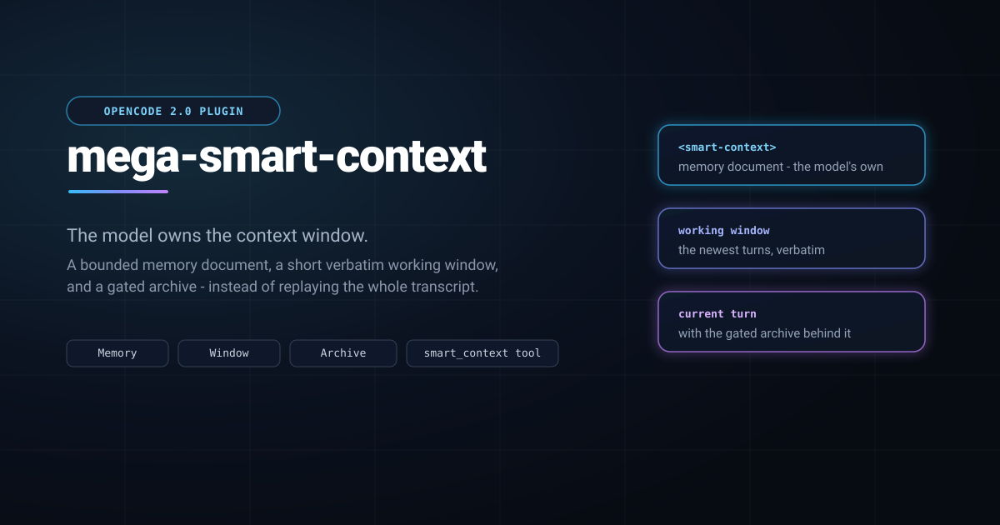

<div align="center">



</div>

# mega-smart-context

An OpenCode 2.0 plugin that hands context management to the model. Instead of replaying the whole transcript, every request carries the memory document the model wrote, a short verbatim working window, and the current turn.

<div align="center">

[](LICENSE)
[](package.json)
[](https://github.com/topics/opencode-plugin)
[](package.json)
[](https://www.paypal.me/mega3dp)

</div>

## What it does

- The model writes a **memory document** with the `smart_context` tool — the goal, plan, facts, files, decisions and open threads — and every request starts with it.
- **The layout is append-only.** The request keeps that document as a **checkpoint** and appends one accepted delta after each completed turn, so a patch does not rewrite the provider prefix; when the shared pool fills, a due note lists what will leave and the fold waits for the next prompt, keeping the newest `compactKeepTokens` (20k default) of turns and archiving the rest. The old snapshot layout lives on the `snapshot` branch.
- **The working window can grow once per era.** At `windowWarnPercent` (80% default) of the pool, the trailing note offers one bounded extension with `smart_context action:"extend" reason:"…"` or a fold; the grant is clamped by the model's real context window, and the next warning is the fold.
- **Oversized tool results are shortened, not lost.** A result over `maxResultChars` keeps a content-aware summary (JSON arrays are sampled, logs keep their errors), and the original stays in the session record behind a `raw: r_…` marker; `smart_context action:"raw" id:"…"` pages it back. The newest result, errors and denials are never shortened.
- A short **verbatim working window** keeps the newest turns exactly as they happened, so nothing in the live tool loop is paraphrased.
- At a fold, the turns that no longer fit move to a **gated archive** with their raw messages, kept for `recall` rather than replayed or dropped silently.
- **Compaction is owned by the plugin.** When the host makes a checkpoint, the plugin first archives every turn it is about to discard (raw kept, so `recall`/`expand` still reach it) and then answers with the memory document itself instead of a separate summarization call; empty memory archives the turns but declines the summary, and the next note says what was saved.
- **Subagents are managed independently**, each with its own window and memory, so a child never inherits the parent's context.
- A **loop guard** watches the current turn for repeated failures and appends at most one short redirect to the trailing state note. It never aborts the turn or changes a tool result. In Code Mode the check command is read from the `execute` code string, so a passing typecheck or test script counts as verification.
- **Project facts** (`projectFacts: true`) learn short environment facts from observed tool outcomes across sessions in the same repository, then inject a small stable block at the start of the next session. They are inspectable, forgettable and never derived from assistant prose.
- **Tool usage** is a read-only project report: completed calls, prompts and sessions per tool, plus unused and never-used tools. Nothing is hidden or denied automatically, and no arguments, outputs or paths are stored.
- `/context` prints the current memory and archive; `/context now` archives pending turns; `/context resume` continues the session without adding a user message or ageing an eviction.

## Requirements

- OpenCode 2.0.
- Node 22 or newer. The host loads the TypeScript source directly; there is no build step and no runtime dependency.

## Install

Project scope (this repository only):

```sh
npm run plugin:install:project
```

User scope (every project on this machine):

```sh
npm run plugin:install
```

Check what is installed and whether it has drifted from the source tree:

```sh
npm run plugin:status
```

Remove the selected scope (`--project` targets the project copy):

```sh
npm run plugin:uninstall
npm run plugin:uninstall -- --project
```

Installing copies the shippable files and removing deletes them; editing the source tree does not change an installed copy until you reinstall. OpenCode picks up a re-synced or removed copy at its next load, so restart it only to make that immediate — and always after a *first* install, when the host has not seen the directory yet.

> **Do not run this alongside `mega-skillstate`** (or any other plugin that rewrites the context hook). Both rewrite the same request and both may own compaction. Disable the other plugin first.

> **Install one scope, not both.** OpenCode reads both discovery roots and keys a plugin by the path it was loaded from, so a user copy and a project copy are two instances of this plugin in a session in that repository: two window passes per request, two owners of compaction, two `/context` commands. Pick user scope to cover every project, or project scope to cover this repository alone. `npm run plugin:status` prints both, so a stray copy is visible there.

## Configure

On first run the plugin writes `~/.config/opencode/mega-smart-context.json` with every default and never overwrites it. Layers, most specific last:

1. built-in defaults,
2. the package `options.json`,
3. the host's plugin options,
4. the user file.

An unknown key or a wrong type is an error; the plugin refuses to load rather than silently keeping a default.

The settings a user normally touches:

| Setting | Default | Meaning |
| --- | --- | --- |
| `enabled` | `true` | master switch |
| `memoryTokens` | `100000` | cap on the model-authored memory, estimated |
| `workingTokens` | `200000` | cap on the verbatim working window, estimated |
| `compactKeepTokens` | `20000` | verbatim turns a fold keeps, estimated |
| `rebuildOnCompaction` | `false` | rebuild the retained tail's bytes at a fold |
| `windowExtend` | `true` | allow one working-pool extension per era |
| `windowExtendFactor` | `2` | requested extension multiplier, clamped 1.1..4 and by the model window |
| `windowWarnPercent` | `80` | pool percent at which the note offers extend or fold, clamped 50..95 |
| `archiveMaxTurns` | `200` | turns kept in the archive before the oldest are dropped |
| `archiveMaxChars` | `400000` | characters kept in the archive before the oldest are dropped |
| `parentArchive` | `true` | let a subagent search its spawning session's archive (`from:"parent"`) |
| `expandDigestChars` | `4000` | characters per `expand` page, clamped by `maxResultChars` |
| `maxResultChars` | `4000` | shorten a tool result larger than this; the original stays retrievable at its raw marker |
| `loopGuard` | `true` | append one short redirect to the trailing state note when the current turn is stuck |
| `loopGuardMode` | `"default"` | `default` (about 20 calls) or `aggressive` (about 14) |
| `loopGuardNudges` | `1` | redirects per prompt-turn; clamped to one |
| `loopGuardMinCalls` | `20` | minimum calls before the guard judges |
| `projectFacts` | `false` | learn short project-level environment facts from observed tool outcomes; off until validated |
| `projectFactsMaxFacts` | `4` | facts in the injected project block, clamped to 0..4 |
| `projectFactsMaxTokens` | `150` | token cap for the project block, clamped to 0..150 |
| `projectFactsPropose` | `false` | reserved for a paid fact proposer; no request-path calls |
| `subagents` | `true` | manage child sessions independently |
| `refs` | `true` | allow feature-map references |
| `updateCheck` | `true` | ask GitHub once a day for a newer version (one TUI toast per release) |
| `sidebar` | `true` | draw the block in the TUI sidebar (`sidebar:false` removes it, keeps the dialog) |
| `debug` | `false` | log pass decisions to stderr |
| `profiles` | `{ deep }` | named bundles of the session-level settings (see below); the package ships `deep` at 100k memory / 200k working |
| `modelProfiles` | `{}` | `provider/model` (or `#variant`, or a bare model id) to a profile name |
| `defaultProfile` | `"deep"` | the profile an auto session falls back to; `""` runs the base config |

Profiles are named bundles of the session-level settings. A session takes, in order, a manual pin, a `modelProfiles` entry for the model in use, `defaultProfile`, or the base config; a manual pin stays until you pick **auto**, whatever model is used later. The package ships `deep` (100k memory, 200k working) as the default, so an auto session reports `deep · default`; defining your own `deep` replaces that body, and `defaultProfile: ""` selects the base config. The retired `contextLayout`, `evictionLead` and `autoArchive` keys are still accepted and ignored, so an older config loads.

```json
{
  "profiles": {
    "lean": { "memoryTokens": 10000, "workingTokens": 12000, "maxResultChars": 2000 },
    "wide": { "memoryTokens": 30000, "workingTokens": 60000, "archiveMaxChars": 200000 }
  },
  "modelProfiles": { "opencode/deepseek-v4.1-flash-free": "lean", "gpt-5": "wide" },
  "defaultProfile": "lean"
}
```

A profile may set only the session keys (`memoryTokens`, `workingTokens`, `compactKeepTokens`, `rebuildOnCompaction`, `windowExtend`, `windowExtendFactor`, `windowWarnPercent`, `charsPerToken`, `archiveMaxTurns`, `archiveMaxChars`, `parentArchive`, `expandDigestChars`, `refs`, `maxResultChars`); the install keys are refused. The retired `evictionLead` and `autoArchive` keys are still accepted and ignored, so an old profile loads. Switch from the sidebar's `[profile]`, the dialog's `Switch profile...`, or `/context profile auto|base|<name>`.

The source repository's [`docs/SPEC.html`](docs/SPEC.html) has the full table and the behavior.

The update check is the only network call the plugin makes, and it runs in the TUI, not in a request: at most one `GET` of this repository's `package.json` per 24 hours, then a toast when the published version is newer than the loaded one. Nothing about it is sent to the model. `"updateCheck": false` in the user file switches it off.

## Use

- The model writes memory with the `smart_context` tool: `read`, `raw`, `patch`, `stats`, `compact`, `extend`, `ref`, `archive`, `purge`, `recall`, `expand`, `notice`. `raw` pages back an original shortened tool result by its marker id; `notice` lists or retires a pinned host notice.
- A turn that left the working window is readable before it is archived: `expand` looks in the archive first and then in the pending queue, and says when a read is not durable. `archive` without `keepRaw` warns that the raw is now gone, so `expand` can only return the gist.
- A subagent can read its spawning session's archive without importing it: `recall`/`expand` with `from:"parent"`. The field is read-only and never reaches a writing action, and the reply tells the child how many characters its caller can actually keep.
- `/context` prints the current memory and archive, and carries the control actions a user needs; the subcommands are in [The `/context` command](#the-context-command).
- The palette command `Context status` opens the same numbers as a dialog, with `Switch profile...`, `Resume` and `Purge a turn...` below them, and the TUI sidebar carries a short block of the same numbers with clickable `status` / `profile` / `resume` / `purge`; see [The TUI status dialog](#the-tui-status-dialog).
- `/undo` is followed: when the host commits a revert, the plugin rolls its own record back with it - memory written in the undone turn is undone, notices it retired are pinned again, purged turns come back, and the memory block says so for that turn. The journal covers the last eight turns; see "Undo" in the SPEC.

Every request starts with a `<smart-context>` block. If `goal` is empty, the model is told to write the request there before the raw first message leaves the working window. That block is a checkpoint; a completed turn that wrote memory carries a `<smart-context-update>` delta, and a `<smart-context-state>` note after the current turn carries the mode and the shared pool.

## The `/context` command

`/context` is the user's window into the same state the model sees. It prints; it does not edit the memory document - the model stays the only writer of the semantic content.

| Command | Effect |
| --- | --- |
| `/context` or `/context status` | the status report: its first line names the product and the loaded build, the second names the profile in force and the model, then memory and working usage against their caps, turns kept and dropped, `over budget`, the goal, the host system size (display only), the pinned notices, the pending evictions and the archive |
| `/context now` | archive every pending turn immediately, instead of waiting for an eviction to age it |
| `/context resume` | start a model turn with the plugin's resume cue through the host's synthetic channel - no user message, no new turn, and no pending eviction aged |
| `/context profile` | print the profile in force (name, how it was chosen, the model), every named profile with its overrides, the model mappings and the default |
| `/context profile auto\|base\|<name>` | pin this session to a named profile, pin it to the base config, or clear the pin so the model mapping and the default decide again |
| `/context memory <key>` | print one memory key as JSON: `goal`, `plan`, `facts`, `files`, `decisions`, `open`, `refs` or `notes` |
| `/context facts` | list active, candidate and retired project facts, with their ids and evidence |
| `/context facts forget <id>` | retire one fact and stop injecting it |
| `/context facts unforget <id>` | restore a forgotten fact |
| `/context tools [all]` | read-only project tool-usage report: used, unused and never-used tools; `all` shows up to 64 used tools |
| `/context recall <query>` | search the archive for a term; lists matching turn ids and gists, marking an entry `(gist only)` when its raw messages are gone |
| `/context purge <turn>` | delete one pending or archived turn by id |

An unknown subcommand prints the usage line. Apart from `resume`, a `/context` reply arrives as a real user turn, so it counts toward the working window and can age a pending eviction.

After `/undo`, the status report adds two lines: `last undo:` (the boundary turn it rolled back to, how many memory keys were restored, how many turns were dropped, and a `not restorable` count when the journal could only do part of the job) and `undo journal:` (how many turns `/undo` would roll back now, and the oldest one it still covers).

## The TUI status dialog

`Context status` (palette id `mega-smart-context.status`) shows the same numbers as `/context` without spending a turn: memory and working usage against their caps, turns kept and dropped, pending/archive/ref counts, and the host system size when the last pass measured one. It is a pull - one call when you run the command, nothing rendered continuously, and no request ever made from a render path.

Below the numbers are three actions:

| Action | Effect |
| --- | --- |
| `Switch profile...` | pick `auto`, `base` or a named profile for this session. `auto` follows the model mapping and then the default; a manual pick stays until you pick `auto` again |
| `Resume` | the same cue `/context resume` sends, through the host's synthetic channel - no user message and no new turn |
| `Purge a turn…` | lists the pending and archived turns, asks which one, confirms, then deletes it from the record. Journaled like the tool's purge, so `/undo` can put it back |

The two halves of the plugin keep separate stores, so the dialog reads the session record over the host's plugin RPC (`stats`, `purge`, `notice`, `profile`). If the host has no RPC bridge, or the open route is not a session, the dialog says why instead of failing; an RPC error is reported the same way. The command id is the keybind key if you want a shortcut - no default binding is claimed. A first install may need a restart before the command appears.

### The sidebar block

The same numbers also sit in the TUI sidebar, appended to `sidebar.content` so they are the last item in its scrollable list: a header of the plugin name with the loaded version against the block's right edge, the profile in force under it (`profile lean · auto`), a memory bar, a working-window bar, turns kept and dropped, pending/archive/ref counts, and how old the numbers are (`measured 6m ago`). The age line took the slot the host system size used to occupy - the size is outside the plugin's budget and the glance cannot act on it, while an old number tells you the block is not current. The header and both bar lines are spread to that same right edge, so the sidebar's own width decides where the version and the numbers land and a wider pane widens the gap rather than the bar; each bar is eighteen cells. The bars' numbers are right-aligned to a shared column so the slashes line up, and an over-cap working line carries a `*` in the gutter before its value. Gists, notice text and the archive list stay out - the block never grows with the session.

Under it are `[status]` (opens the dialog), `[profile]` (the picker), `[resume]` (asks first, then sends the cue) and `[purge]` (the same list and confirmation as the dialog). Each acts when the mouse button is released, so the dialog a click opens is not dismissed by that same release. The block renders from a per-session mirror that is pulled once when the session is shown, once after each idle pass, and again after a purge; at most one pull per session is in flight, a repeat inside fifteen seconds is skipped, and the mirror keeps the thirty-two most recent sessions. Renders never call the RPC.

If the slot API or the JSX runtime is missing the dialog still works, and its `sidebar:` row says `unavailable`; `"sidebar": false` turns the block off.

### The session panel

`Context panel` (palette id `mega-smart-context.panel`) opens the full report in the host's session panel: both budgets, the request's own system-prompt size, the goal, a sparkline of the last forty passes, every pending and archived turn with `[purge]`, the pinned notices with `[retire]` on the superseded ones, and the undo state. The newest notice is the live instruction and has no retire action.

The footer offers `[refresh] [resume] [dialog] [close]`. Purge and retire ask first, write through the same RPC, then refresh the shared mirror. It is independent of `sidebar`: the block's setting only skips the block's own claim. A host without the panel API reports `panel: unavailable` in the dialog.

## Installer

`scripts/install.ts` copies the shippable set (`package.json`'s `files[]` plus `package.json`) into:

- user: `~/.config/opencode/plugins/mega-smart-context`
- project: `<repo>/.opencode/plugin/mega-smart-context`

It is idempotent by content hash: an in-sync copy is left alone; a drifted copy is resynchronized. `--status` reports missing, changed and extra files without copying; `--help` prints the flags, and `--uninstall` is an alias for `--remove`. It never copies `node_modules`.

## Checks

```sh
npm install
npm run typecheck     # tsc --noEmit, strict
npm run smoke         # the context pass: memory injection, the working window, raw storage, profiles, the archive
npm run test:install  # the installer's copy/drift/remove assertions
npm run analyze       # read a recording back: enabled payload vs disabled baseline, effective tokens and cost
```

## Where the details live

- [`docs/SPEC.html`](docs/SPEC.html) — the user-visible behavior in full.
- [`docs/features/`](docs/features/index.html) - the feature map for this plugin itself: the handoff and append-only layout, the memory tool and raw storage, profiles, the archive, subagents, refs, compaction, the install, the analyzer, and the terminal half (status dialog, sidebar block and update toast).
- [`AGENTS.md`](AGENTS.md) — how to work on the plugin.
- [`HANDOFF.md`](HANDOFF.md) — where things currently stand.

## Buy me a coffee

This plugin is free and MIT-licensed. If it earns its keep, you can [buy me a coffee via PayPal](https://www.paypal.me/mega3dp).

## License

MIT — see [`LICENSE`](LICENSE).

Copyright (c) Evert Chin
